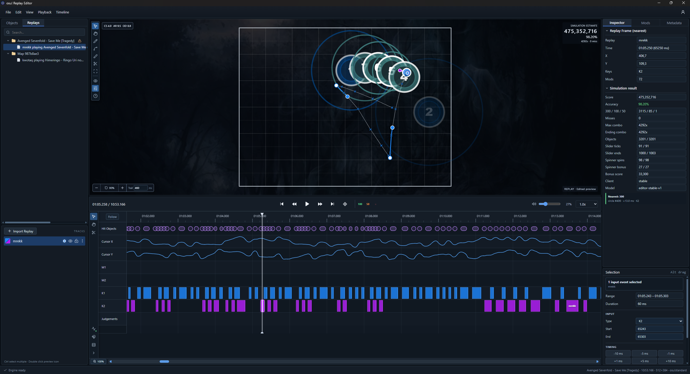
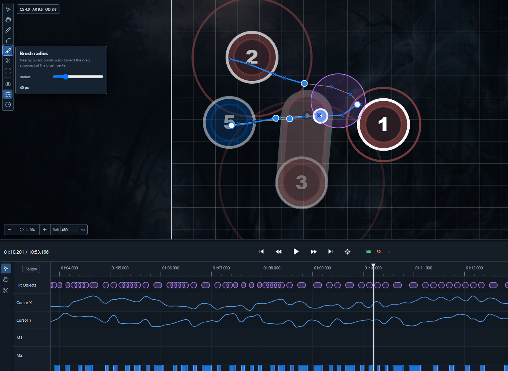
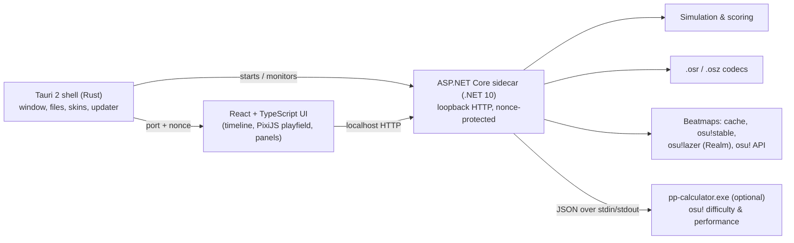

# osu! Replay Editor

[](https://github.com/angrabo/osu-replay-editor/releases/latest)
[](#download)
[](https://tauri.app)

A Windows desktop editor and analyzer for osu!standard replays. Load `.osr` files from
osu!stable or osu!lazer, see exactly how each object was judged, edit cursor movement and
key presses, and re-simulate the score by stable or lazer rules, including pp.



> [!WARNING]
> This tool is for **replaying, analyzing and cleaning up your own gameplay**: studying a
> play frame by frame, finding why a combo broke, or tidying a misclick on a personal
> attempt. It is **not** meant for submitting edited replays as legitimate scores, and the
> author does not condone using it to cheat, forge or misrepresent gameplay. Doing so is on
> you, not this project.

## Download

Get the installer or the portable ZIP from the
[latest release](https://github.com/angrabo/osu-replay-editor/releases/latest). The app
updates itself: Settings › General › Check for updates.

Requires Windows 10 or 11 (x64) and the Microsoft Edge WebView2 Runtime, which Windows
usually already has.

## Features

### Analysis

- **Judgements on the timeline.** Every 100, 50, miss and slider break is marked. Click an
  object to see the press that judged it, how early or late it was, and where the cursor was
  on the circle.
- **Miss analyzer.** The Misses tab explains each miss: too early, too late, off the circle
  (and by how much), no press, notelock (stable), a press spent on another object, a broken
  slider or an unfinished spinner.
- **Suspicious tab.** Flags parts of a replay that do not look hand-played: cursor jumps and
  snaps, stray frames, perfectly straight lines, and timing or key holds that are too even.
  Findings can be ignored per project.
- **Navigation.** Jump to the next miss, 100, 50 or combo break; drop markers with notes on
  the timeline.
- **Playfield overlays.** Slider tracking, a cursor speed heatmap, frame markers, ghost
  cursors of other replays, and the original replay next to the edited one in split view.
- **Live stats.** Score and combo follow the playhead through every slider tick. Text panels
  on the playfield show any value with your own template, such as `{{combo:32b}}x` or
  `{{pp}}pp`.

### Editing

- **Cursor.** Move cursor nodes (with magnetic falloff), brush the path, draw a new one, drag
  a box to select nodes, smooth or straighten a range. The cursor may leave the playfield.
- **Key presses.** Move, resize, cut, add and delete M1/M2/K1/K2 presses on the timeline.
  Editing presses never moves the cursor path.
- **Everything undoable**, with brush strokes and drags applied once per frame so long replays
  stay smooth.



### Simulation, scoring and pp

- **Stable or lazer.** Pick the game a replay is for; the simulation judges and scores it by
  that game's rules (ScoreV1, ScoreV2 or lazer scoring, lazer's slider and spinner rules,
  stable notelock). Unedited replays are checked against their recorded result.
- **Mods.** All osu!standard mods of the chosen game, including lazer-only ones such as
  Classic and Difficulty Adjust.
- **Performance points.** An optional calculator built on osu!'s own code gives the pp and
  star rating of each simulated play, matching the game. It is a separate download (about
  50 MB) from Settings › General.

### Export and projects

- **Export `.osr`** for osu!stable or osu!lazer. A replay played on stable can be exported for
  lazer; its lazer score details are built from the simulation.
- **Export clips** as MP4 (with the map's audio) or GIF.
- **Projects (`.oreproj`).** One file keeps every replay, its edits, markers and view settings.
  Ctrl+S saves in place, and autosave runs every 15 minutes by default.

### osu! integration

- **Beatmaps found automatically**: from your osu!stable Songs folder, your osu!lazer
  library, or downloaded with your osu! account. Sign in with a password, or reuse the
  session osu!lazer already has.
- **Your skin and hitsounds** from osu!stable: circles, cursor, numbers, slider colours and
  the map's hitsounds with your skin's samples.

## Architecture



The Tauri shell starts a local ASP.NET Core sidecar on a random loopback port and gives the
UI a one-time nonce that every request must carry. The sidecar owns replay parsing and
writing, beatmap lookup and caching, osu! sign-in and the simulation; the UI handles
presentation and editing.

The pp calculator is a separate program built on the official `ppy.osu.Game` packages. It is
published with each release and downloaded on demand, so osu!'s large dependencies stay out
of the main app.

| Path | What it is |
| --- | --- |
| `apps/desktop` | React UI and the Tauri shell (`src-tauri`) |
| `packages/beatmap-viewer` | PixiJS playfield renderer, `.osu` parser, slider tracking, hitsounds |
| `engine/ReplayEditor.Engine` | The sidecar: HTTP endpoints and services |
| `engine/ReplayEditor.Simulation` | Judging and scoring for stable and lazer |
| `engine/ReplayEditor.Osu` | `.osr` reader and writer, beatmap archives |
| `engine/ReplayEditor.Api` | osu! sign-in, beatmap lookup (API, stable Songs, lazer Realm) |
| `engine/ReplayEditor.PerformanceCalculator` | The optional pp calculator |
| `tests/` | Engine (xUnit) and frontend (`node:test`) tests |

## Development

### Requirements

- Windows x64
- Node.js 24 and npm 11
- .NET SDK 10
- Rust (MSVC toolchain, `x86_64-pc-windows-msvc`) and the Windows build tools Tauri 2 needs

### Getting started

```powershell
npm install
npm run dev
```

`npm run dev` builds the sidecar, copies it into `apps/desktop/src-tauri/binaries`, starts
Vite and opens the Tauri window. The first Rust build takes a few minutes.

`npm install` creates `app.config.json` from `app.config.example.json`. To sign in with a
password, put your own osu! OAuth client in `osu.clientId` / `osu.clientSecret` there, or set
`OSU_CLIENT_ID` / `OSU_CLIENT_SECRET`. Release builds get real values from repository
variables (see `.github/workflows/release.yml`).

The UI also runs in a browser at `http://localhost:1420/?viewer-fixture` with a built-in test
map and replays, which is handy for working on the interface without the sidecar.

### pp calculator in development

A development build cannot download the calculator for a version that has not been released.
Build it locally and point the sidecar at it:

```powershell
dotnet publish engine/ReplayEditor.PerformanceCalculator -c Release -r win-x64 --self-contained true -p:PublishSingleFile=true -p:EnableCompressionInSingleFile=true -o .build/pp-calculator
$env:ORE_PP_CALCULATOR = "$PWD\.build\pp-calculator\pp-calculator.exe"
npm run dev
```

### Commands

```powershell
npm run check            # TypeScript check
npm run format           # Prettier
npm run test:viewer      # frontend tests: parser, replay math, hitsounds, mods, suspicion, projects
npm run test:replay      # editor store tests + replay codec tests
npm run test:simulation  # judging and scoring tests
npm run test:auth        # osu! sign-in and beatmap lookup tests
npm run build            # release sidecar + Tauri installer
dotnet build ReplayEditor.slnx
```

### Releasing

```powershell
npm run release -- -Version 1.2.3 -Push
```

This sets the version in the four version files, commits `release v1.2.3`, tags it and pushes.
The tag starts the release workflow. It builds the installer, the portable ZIP, the pp
calculator and the updater manifest (`latest.json`), and attaches them to a draft release.
Publish the draft (with its notes) to make the update available:

```powershell
gh release edit v1.2.3 --notes-file release-notes-v1.2.3.md --draft=false
```

---

This is an unofficial, independent project. It is not affiliated with, endorsed by, or
associated with osu! or ppy Pty Ltd in any way. "osu!" and related marks belong to their
respective owners. The pp calculator uses osu!'s MIT-licensed code; osu!'s game resources are
not included.
